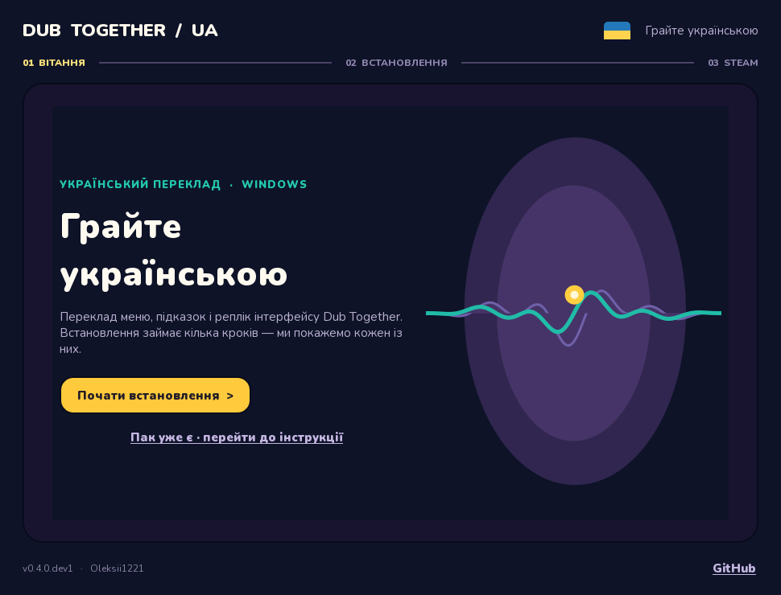

<div align="center">

# Dub Together UA

### Грайте українською

Український переклад **Dub Together** для Windows.
Один EXE, покрокове встановлення, зрозуміла інструкція для параметрів запуску.
Автор перекладу та інсталятора: **Kico**.

[Сайт](https://oleksii1221.github.io/DubTogether-UA/) ·
[Встановити для Windows](https://github.com/Oleksii1221/DubTogether-UA/releases/latest/download/DubTogether-UA-Installer.exe) ·
[Повідомити про проблему](https://github.com/Oleksii1221/DubTogether-UA/issues)

</div>



> **Версія 1.0.3:** стабільний реліз у `master`. Подальша розробка — у `dev`.

## Що робить інсталятор

1. Після відкриття **лише показує вікно** — гра продовжує працювати.
2. На кнопці «Почати встановлення» показує попередження про закриття гри.
3. Тільки після підтвердження перевіряє підтримувану збірку, делікатно
   закриває Dub Together і створює український `.pck` у `%LOCALAPPDATA%`.
4. Показує прогрес, стадію помилки, готовий рядок для Steam і кнопки копіювання.

Оригінальний `DubTogether.exe` та файли в каталозі Steam не перезаписуються.
Інсталятор не завершує гру примусово: якщо вона не закриється упродовж 20 секунд,
зупиниться з повідомленням і попросить закрити її вручну.

## Встановлення для гравця

1. [Завантаж `DubTogether-UA-Installer.exe`](https://github.com/Oleksii1221/DubTogether-UA/releases/latest/download/DubTogether-UA-Installer.exe) для Windows.
2. Відкрий EXE, збережи свій прогрес у грі, натисни **«Почати встановлення»**.
3. Прочитай попередження та підтвердь. Дочекайся завершення.
4. Натисни **«Копіювати»** біля повного рядка `--main-pack "..."`.
5. У Steam відкрий **Бібліотека → Dub Together → шестерня → Властивості → Загальні → Параметри запуску** й встав увесь рядок.
6. На останньому екрані інсталятора натисни **«Готово»**, щоб закрити його.
7. Запусти гру через Steam. За потреби вибери **Українська** в налаштуваннях мови.

Інсталятор перевіряє відбитки лише тих скриптів гри, які змінює переклад.
Хотфікси інших файлів не блокують встановлення. Якщо Steam змінить один із
потрібних скриптів, інсталятор безпечно зупиниться й не торкнеться файлів гри.

## Розробка

Код програми та інструментів — **Python 3.12**. Вікно побудоване на **PySide6 / Qt**.
Бінарні зміни гри зберігаються як патчі. Повного PCK чи EXE гри в репозиторії немає.

```powershell
py -3.12 -m venv .venv
.\.venv\Scripts\python.exe -m pip install -r requirements-build.txt
$env:PYTHONPATH = 'src'
.\.venv\Scripts\python.exe tools\audit_translations.py
.\.venv\Scripts\python.exe -m unittest discover -s tests -v
.\.venv\Scripts\python.exe -m dubua
.\.venv\Scripts\python.exe tools\build_windows.py
```

Результат збірки: `dist/DubTogether-UA-Installer.exe`. `tools/rebuild_from_game.py`
відтворює бінарні патчі з **власної копії гри** за допомогою зовнішнього
[GDRETools](https://github.com/GDRETools/gdsdecomp); приклад:

```powershell
.\.venv\Scripts\python.exe tools\rebuild_from_game.py --game 'C:\Path\To\DubTogether.exe' --gdre 'C:\Path\To\gdre_tools.exe'
```

Переклади редагуються в [`translations/uk.json`](translations/uk.json).
Інструмент `tools/catalogue_to_gd.py` перетворює JSON на GDScript перед
повторним збиранням патчів. Автоматична перевірка ловить порожні та незмінені
англійські рядки, відсутні кнопки екрана запису та зіпсовані `%s`/`%d`.

### Структура

| Шлях | Призначення |
| --- | --- |
| `src/dubua/ui.py` | Покрокове вікно, прогрес та інструкція |
| `src/dubua/installer.py`, `pck.py`, `game.py` | Пошук гри, створення PCK, делікатне закриття |
| `translations/uk.json` | Український каталог |
| `tools/` | Аудит, відтворення патчів, збірка Windows EXE |
| `docs/` | Статичний сайт для GitHub Pages |

## Сайт і статистика

Сайт лежить у `docs/` і публікується через GitHub Pages. На ньому одна кнопка
встановлення, яка веде прямо на `DubTogether-UA-Installer.exe` з останнього
GitHub Release, компактне меню всіх попередніх версій, а також посилання на
Steam-профіль автора й репозиторій. Старі інсталятори не видаляються з релізів.

Umami підключено через публічні `scriptUrl` і `websiteId` у
[`docs/config.js`](docs/config.js). Приватні токени в репозиторії не зберігаються.
Статистика DubTogether-UA відокремлюється шляхом `/DubTogether-UA/`, а клік по
кнопці встановлення записується як подія `download-windows`. Лічильник файлів
також доступний на сторінці GitHub Release.

## Гілки, участь і ліцензії

- `dev` — розробка, Windows збірка в Actions як артефакт.
- `master` — перевірені релізи; оновлюється вручну після перевірки.

Пропонуй виправлення перекладу через Pull Request у `dev`, бажано зі знімком
екрана й поясненням контексту. Ніколи не додавай до репозиторію повний PCK,
EXE гри, збереження або особисті дані зі Steam.

**Код** — [MIT](LICENSE). **Авторський переклад** — [CC BY-NC 4.0](CONTENT-LICENSE.md)
у межах прав автора; він призначений для безкоштовного некомерційного
поширення. MIT сама по собі дозволяє комерційне використання коду.
Сторонні компоненти й знімки описані в [THIRD_PARTY.md](THIRD_PARTY.md).

Dub Together UA — неофіційна робота спільноти, не пов'язана з розробниками гри.
